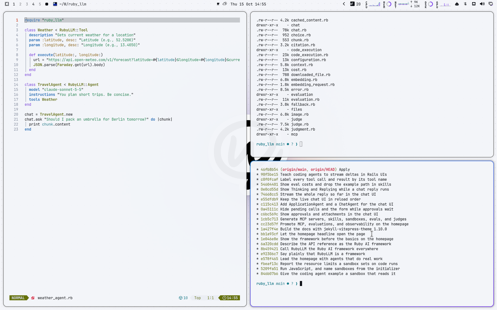

# Chat with Work Light for Omarchy Quattro

A cool, airy light theme with Chat with Work's violet and rainbow glow, sampled from the chatwithwork.com design.



## Install

```bash
omarchy theme install https://github.com/crmne/omarchy-chat-with-work-light-theme.git
```

Activate it with:

```bash
omarchy theme set chat-with-work-light
```

## Architecture

This is a declarative Omarchy Quattro theme. It provides only:

- A semantic palette in `colors.toml`
- A GNOME icon theme choice in `icons.theme`
- Wallpapers in `backgrounds/`
- A selector preview in `preview.png`
- A boot unlock logo in `unlock.png`, with its selector preview in
  `preview-unlock.png`

Omarchy generates and applies the terminal, shell, Hyprland, editor, browser,
Obsidian, keyboard, and btop integrations from the semantic palette. The theme
contains no executable hooks, package installation, or application-specific
configuration files.

## Core colors

Sampled from the design tokens of [chatwithwork.com](https://chatwithwork.com).

- Accent: `#7a3cf0`
- Muted: `#7c8599`
- Background: `#f3f5f9`
- Surface: `#ffffff`
- Foreground: `#0a0d14`
- Secondary text: `#5a6374`

## Wallpapers

Original wallpapers made for this theme from the brand's own artwork:

- `01-sticker.jpg`: The sticker mark centered with a soft float shadow over the orbit centre's blurred rainbow glow, on the site's 22px dot grid
- `02-orbit.jpg`: The connector orbit from the marketing page: solid inner ring, dashed middle ring, faint outer ring, mark in a surface disc at the centre, signal-colored satellites
- `03-live-wire.jpg`: A hairline "live wire" across the middle, lit with the rainbow and one orange dot, over a very soft low rainbow aurora and fading dot field

## Requirements

Omarchy 4 (Quattro) or newer.

## License

[MIT](LICENSE)
